<b>MithrandirHEX</b> · Security Researcher

> **Mission brief.** I break things to make them safer. TODO: describe your work here.
>
> **Current objective.** TODO: what you are researching right now.

#### Telemetry

Reading the instruments

- **Accretion disk:** one particle per day of the last year; brighter and closer to the hole means a busier day. Inner rings orbit faster, as they would around a real black hole.
- **Orbit:** contributions per month, plotted as a closed trajectory; the beacon marks the busiest month.
- **Spectral composition:** language share by bytes across public repositories.
- **Light theme:** rendered as a photographic negative, the way astronomical survey plates were printed.

Artwork: original animated SVG, generated by README Templates · template: Singularity. Motion stops if your system asks for reduced motion.

